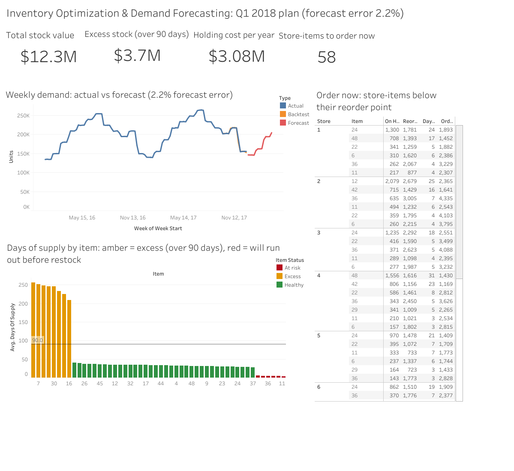
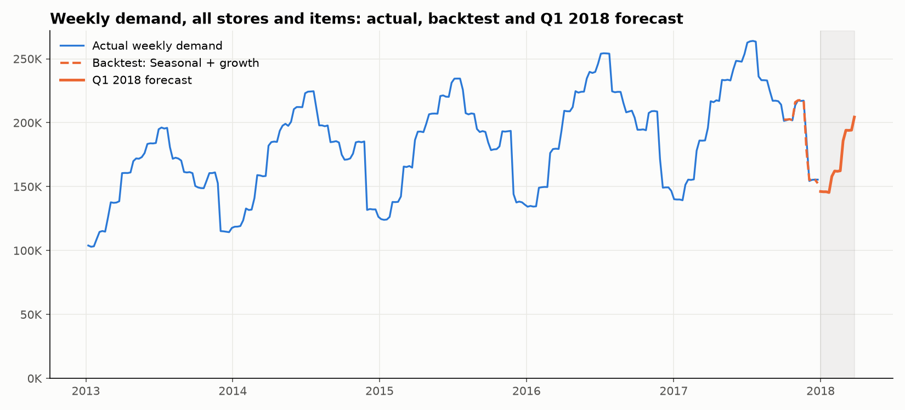
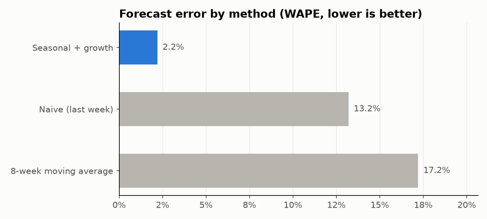
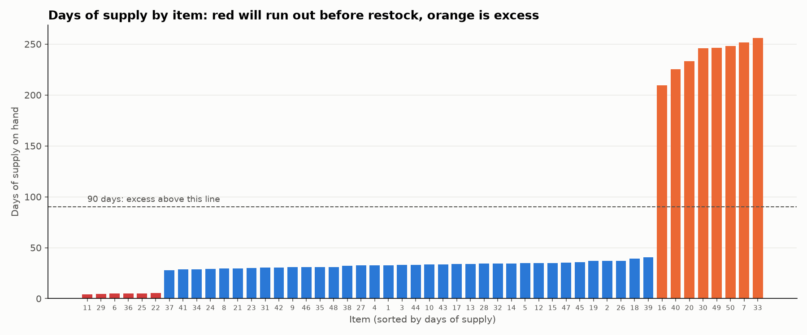
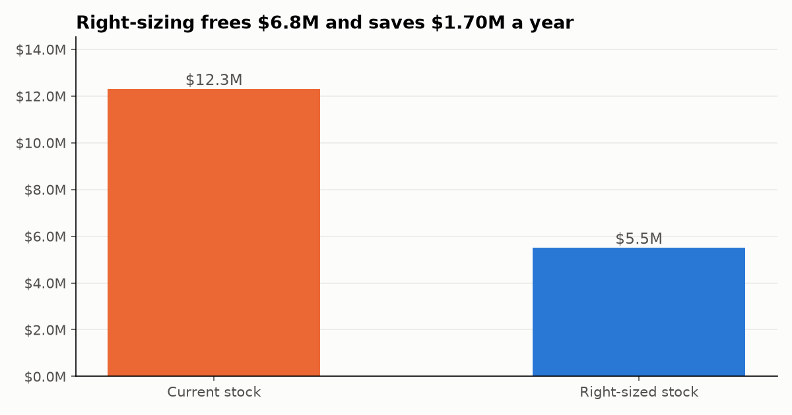

# Inventory Optimization & Demand Forecasting

**Forecasting weekly demand and setting safety stock, reorder points and order actions for 10 stores × 50 items, using SQL, Python and Tableau.**

🔗 **[View the interactive Tableau dashboard](https://public.tableau.com/app/profile/abrar.ahmed.syed4247/viz/InventoryOptimizationDemandForecasting/InventoryDashboard)**



---

## Business Problem

A retail chain carries **$12.3M of stock** across 10 stores, yet some shelves run empty while others overflow. Management asked:

1. How much will each item sell next quarter?
2. How much safety stock is needed, and when should each item be reordered?
3. Which items are slow-moving or overstocked?
4. What does holding all this inventory cost?

**Goal:** fewer stockouts, less cash tied up in stock, and lower holding costs.

---

## Data

| Source | File | Description |
|---|---|---|
| **Kaggle** ([Store Item Demand Forecasting Challenge](https://www.kaggle.com/competitions/demand-forecasting-kernels-only/data)) | `train.csv` | 913,000 daily sales records: 10 stores × 50 items, Jan 2013 – Dec 2017 |
| Documented assumptions (`python/00_build_assumptions.py`) | `items.csv` | Category, unit cost, unit price and supplier per item |
| | `suppliers.csv` | 6 suppliers with promised lead times |
| | `purchase_orders.csv` | 8,804 purchase orders in 2017 with order and received dates |
| | `inventory_snapshot.csv` | Stock on hand and on order at 31 Dec 2017 |

The Kaggle data contains sales only. Costs, lead times and stock levels are **assumptions built from the real sales**, stated openly here, because an inventory analysis needs them.

**Other assumptions:** holding cost = 25% of stock value per year; 95% service level (Z = 1.65); reorder about every 4 weeks; more than 90 days of supply counts as excess.

> `train.csv` is not stored in this repo, to respect Kaggle's competition rules. Download it from the link above into `data/raw/`.

---

## Tools

| Tool | Used for |
|---|---|
| **SQL (DuckDB)** | Data validation, weekly demand, seasonality, ABC analysis, supplier lead-time performance, stock health and holding costs |
| **Python (pandas, matplotlib)** | Forecast backtesting, Q1 2018 forecast, safety stock, reorder points, order recommendations, charts |
| **Tableau Public** | Interactive inventory dashboard with KPI cards, forecast, days of supply and the order list |

---

## Approach

1. **Validate the data (SQL):** 913,000 rows = 1,826 days × 10 stores × 50 items, so there are no missing days. There are also 0 missing values, 0 negatives and 0 duplicates.
2. **Find the demand patterns (SQL):** yearly growth, monthly seasonality, the weekday effect, and fast vs slow movers.
3. **Classify and diagnose (SQL):** ABC analysis by value, supplier promised vs actual lead times, days of supply, excess, stockout risk and holding cost.
4. **Forecast (Python):** backtested 3 methods on the last 13 weeks of 2017, then forecast Q1 2018 with the most accurate one.
5. **Set the policy (Python):** safety stock and reorder point for all 500 store-items, plus an order-now or pause action for each.
6. **Communicate (Tableau):** a one-page dashboard a buyer can act on.

---

## Key Insights

### Headline numbers

| Stock value | Excess stock (>90 days) | Holding cost / year | Forecast error | Store-items to order now |
|---|---|---|---|---|
| $12.3M | $3.5M | $3.08M | **2.2%** | 58 |

**1. Demand is growing and strongly seasonal.**
- Units sold grew **35%** from 2013 to 2017 (7.9M → 10.7M), but growth slowed to **3.6%** in 2017.
- **July** sells **1.9× January** (seasonality index 128 vs 68), and **Sunday** sells **1.5× Monday**.

**2. A seasonal forecast is 6–8× more accurate than simple methods.**

| Method | Error (WAPE) | Bias |
|---|---|---|
| **Seasonal + growth** | **2.2%** | −0.2% |
| Naive (last week) | 13.2% | +12.2% |
| 8-week moving average | 17.2% | +17.2% |

The simple methods **over-forecast by 12–17%** heading into the winter low, which is exactly how excess stock builds up. The Q1 2018 forecast is **2.20M units, +4.3%** on Q1 2017.




**3. Half the stock money sits in 8 items.**
- **8 items** hold **$6.0M (49%)** of all stock value, with **213 days** of supply on average. They turn only **1.7–2.1 times a year**, against about **11** for healthy items.
- The stock above 90 days of supply is worth **$3.46M** and costs **$865K a year** to hold.

**4. At the same time, high-value items are about to run out.**
- **10 items** (mostly class A) have less stock than their supplier's lead time.
- Items **6 and 36** have about **4.5 days** of stock against a **21-day** lead time, so they'll be out of stock for about two weeks even if ordered today.



**5. Supplier averages hide the real risk.**
- On average, suppliers deliver within about a day of their promise.
- But **Overseas Imports** is late on **55%** of orders, and its worst delivery took **41 days** against a 21-day promise.
- **Lead-time variability, not the average, is what forces extra safety stock.**

**6. ABC: 22 of 50 items (A class) hold 80% of inventory value.** They deserve weekly review; the 12 C items (5.5% of value) can follow simple rules.

**7. Ignoring seasonality is expensive.** Reorder points based on the flat 2017 average would be **21% too high** for Q1, the low season.

---

## Recommendations

| # | Recommendation | Impact |
|---|---|---|
| 1 | **Place the 58 urgent orders now**, prioritising A items 6, 11, 22, 29 and 36 | 144,038 units ($2.8M); prevents stockouts on the highest-value items |
| 2 | **Pause purchasing on the 8 excess items** and clear stock through promotions or store transfers | Frees **$3.5M** of cash; saves **$865K a year** in holding costs |
| 3 | **Replace flat reorder points with seasonal, forecast-based ones** | Reorder points **21% lower** in Q1; less winter overstock |
| 4 | **Renegotiate with Overseas Imports, or add a second supplier** | Lower lead-time variability means less safety stock is needed |
| 5 | **Roll the forecast-driven policy out to all 500 store-items** (95% service level, 4-week cycle) | Stock from $12.3M to $5.5M: frees **$6.8M**, saves **$1.7M a year** |

*Impact 5 includes impact 2 and depends on the 4-week order cycle assumption.*



---

## Key Formulas

```
Safety stock  = Z × √( lead time × demand std² + daily demand² × lead-time std² )
Reorder point = daily demand × lead time + safety stock
Days of supply = on-hand units ÷ daily demand
Holding cost  = stock value × 25% per year
```

---

## Repository Structure

```
Inventory-Optimization-Forecasting/
├── data/
│   ├── raw/          # Kaggle train.csv (download) + assumption files
│   └── processed/    # weekly_forecast.csv, forecast_accuracy.csv, inventory_plan.csv
├── sql/
│   ├── 01_load_and_quality_check.sql
│   ├── 02_demand_patterns.sql
│   ├── 03_abc_and_suppliers.sql
│   └── 04_stock_health_and_costs.sql
├── python/
│   ├── 00_build_assumptions.py     # costs, suppliers, purchase orders, stock levels
│   ├── run_sql.py                  # runs a .sql file against DuckDB
│   ├── 01_demand_forecast.py       # backtest + Q1 2018 forecast
│   ├── 02_inventory_policy.py      # safety stock, reorder points, actions, costs
│   └── 03_export_for_tableau.py
├── tableau/          # dashboard data file
├── images/           # charts and dashboard screenshot
├── requirements.txt
└── README.md
```

---

## How to Run

1. Download `train.csv` from [Kaggle](https://www.kaggle.com/competitions/demand-forecasting-kernels-only/data) into `data/raw/`.
2. Then run:
```bash
pip install -r requirements.txt
python python/00_build_assumptions.py
python python/run_sql.py sql/01_load_and_quality_check.sql
python python/run_sql.py sql/02_demand_patterns.sql
python python/run_sql.py sql/03_abc_and_suppliers.sql
python python/run_sql.py sql/04_stock_health_and_costs.sql
python python/01_demand_forecast.py
python python/02_inventory_policy.py
python python/03_export_for_tableau.py
```

---

## What I Learned

- **Test forecasts before trusting them.** A backtest on unseen weeks showed simple methods would have over-ordered by 12–17%.
- **Variability drives safety stock.** Suppliers looked on time on average, but the late deliveries decide how much buffer you need.
- **A business can have too much and too little stock at the same time.** Looking at item level, not totals, revealed both problems.
- **State your assumptions.** Where real data didn't exist, I built transparent assumptions and documented them.

---

**Abrar Ahmed Syed** · [LinkedIn](https://www.linkedin.com/in/abrar313) · [Portfolio](https://abuabrar09.github.io) · [Tableau Public](https://public.tableau.com/app/profile/abrar.ahmed.syed4247/viz/InventoryOptimizationDemandForecasting/InventoryDashboard)
